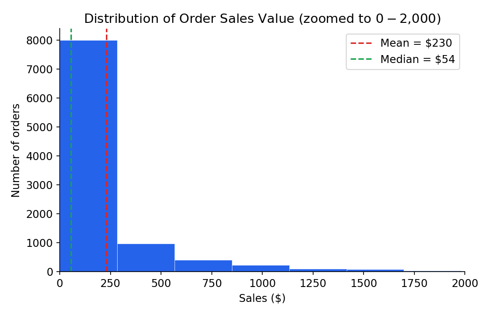
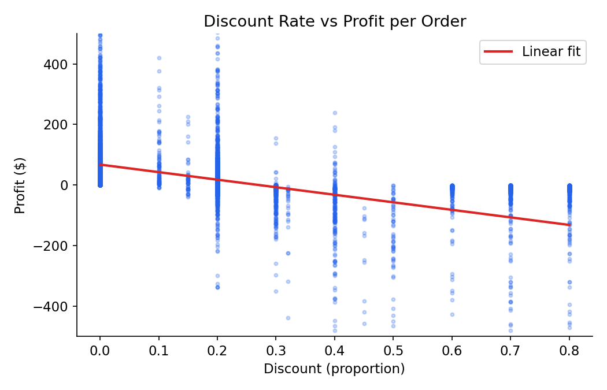
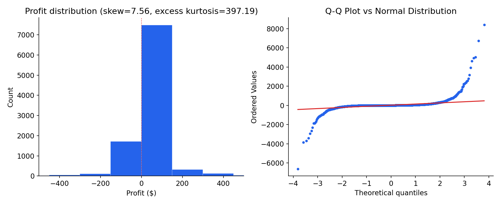

# 02 — Does Discounting Hurt Profitability?

> Part of [Data Analysis Foundations](../README.md).

 

## Executive summary

Discounting does hurt profit, but not gradually: profitability holds up below about **30%** discount and collapses above about **31%**. On 9,994 order lines from the **Sample Superstore** dataset (2015–2018), only 0–18% of orders lose money below the threshold, against **89–100%** above it. The sharp break, not the discount level itself, is the actionable finding, and it supports a flat **30% manager-approval rule** instead of a blanket policy against discounting.

## Business question

Retailers use discounts to close sales, but every discount comes straight out of the order's margin. Is there a point at which a discount stops being a sales tool and starts being a loss-generating habit?

- **H0:** no relationship between Discount and Profit (ρ = 0)
- **H1:** a relationship exists (ρ ≠ 0)
- **Predictor:** Discount (continuous, 0 to 0.8). **Outcome:** Profit (continuous, dollars, can be negative)

## Key findings

- **The relationship is real but not linear.** Pearson r = −0.22 vs Spearman ρ = −0.54 (both p < .001). Discount alone explains only 4.8% of profit variance, and the gap between the two correlations is itself the finding.
- **Threshold effect:** the discount-band table carries the practical signal.

| Discount band | Mean profit | Orders sold at a loss |
|---|---|---|
| 0% | $66.90 | 0.0% |
| 1–15% | $71.56 | 14.4% |
| 16–30% | $20.59 | 18.3% |
| 31–45% | −$114.51 | 89.3% |
| 46–60% | −$129.66 | 100.0% |
| 60%+ | −$98.35 | 100.0% |

- **Skewed data:** sales are right-skewed (mean $230 vs median $54) and profit is very heavy-tailed (skewness about 7.6), so rank-based Spearman is reported next to Pearson.
- **With n = 9,994, even small effects reach significance**, so the loss-rate table, not the p-value, is what supports the decision.


## Charts

| | |
|---|---|
|  |  |
| Order sales value: heavily right-skewed | Discount rate vs profit per order, with linear fit |



## Recommendation

Require manager approval for any discount above **30%**. A single flat threshold is easy to enforce and audit, and it sits exactly where the loss rate jumps from about 18% to about 89%. It is not perfect: Furniture tends to stay profitable past 30% while Office Supplies can tip into losses earlier, so a category-specific cap could fix that, but it is not worth the added complexity until the flat cap has run for a quarter.

## Data quality notes

- The source file (a public GitHub mirror) contained 806 fully blank rows, removed during cleaning; the cleaned count (9,994) matches the dataset's documented size.
- 11 records (0.1%) were missing a postal code, which is not relevant to this analysis.

## Repository structure

```
02-discount-profitability-analysis/
├── notebook/
│   ├── discount_profitability_analysis.ipynb # Cleaning, descriptives, plots, IQR outliers, hypothesis test, distribution analysis
│   └── data/superstore.csv
├── figures/                                 # Charts from the report
└── report/Business_Report.pdf               # Business-audience report
```

## How to run

```bash
pip install pandas numpy scipy matplotlib seaborn jupyter
cd notebook
jupyter notebook discount_profitability_analysis.ipynb   # Run All
```

## Limitations and future work

- Historical data from a single US retailer: the 30% threshold reflects that company's cost structure and product mix. Treat it as a finding to investigate for a given business, not a universal rule.
- Discount alone is a weak predictor (R² = 0.048); a multivariate model including category, region and segment would be the natural next step.
- Next steps: category-specific caps, a cost-of-discount simulation, and a small dashboard for the approval threshold.
