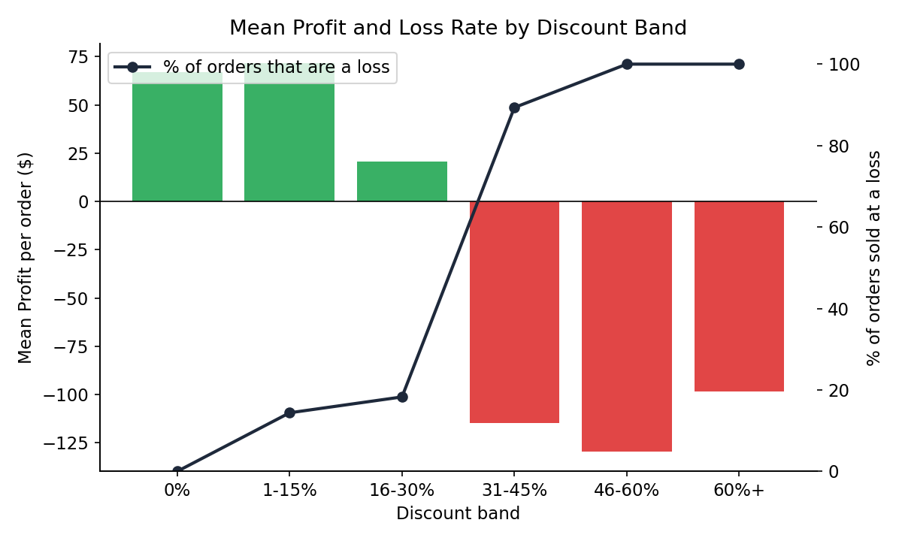

# Data Analysis Foundations

> Two analytical projects that form the base of my portfolio work: cleaning and exploring data in two languages, then using a statistical test to answer a business question. Author: Hayagriva Boodhoo.

  

## Projects

| Project | Question | What it shows | Tools |
|---|---|---|---|
| [`01-data-cleaning-python-r`](01-data-cleaning-python-r) | How do you turn a messy census file into analysis-ready data? | The same cleaning, transformation and summary workflow written twice, in Python and in R, on 48,842 rows | Python (pandas), R (dplyr, ggplot2) |
| [`02-discount-profitability-analysis`](02-discount-profitability-analysis) | At what discount level does a sale start losing money? | A hypothesis test plus discount-band analysis with a concrete business recommendation (flat 30% approval threshold) | Python (pandas, SciPy, matplotlib) |

## Headline result

From project 02: below about 30% discount only 0–18% of orders lose money; above about 31%, **89–100%** do.



## Skills demonstrated

- Data cleaning decisions with a documented reason for each (mode imputation for categorical gaps, whitespace stripping, type conversion, derived features)
- Cross-language fluency: equivalent Python and R implementations
- Statistical testing (Pearson, Spearman, normality, skewness) and reading results honestly, including noting when significance is not the same as importance
- Turning a statistical result into a business recommendation, with its limitations stated

## Repository structure

```
.
├── 01-data-cleaning-python-r/
│   ├── data/adult.csv
│   ├── data_cleaning.ipynb
│   ├── data_cleaning.R
│   └── README.md
├── 02-discount-profitability-analysis/
│   ├── notebook/ (notebook + data/superstore.csv)
│   ├── figures/
│   ├── report/Business_Report.pdf
│   └── README.md
└── README.md
```

## Related project

For a full end-to-end machine learning project, see **Telco-Churn-ML-Capstone**.

Both projects use public datasets (UCI Adult Income, Sample Superstore) and are analysis exercises, not production systems.
